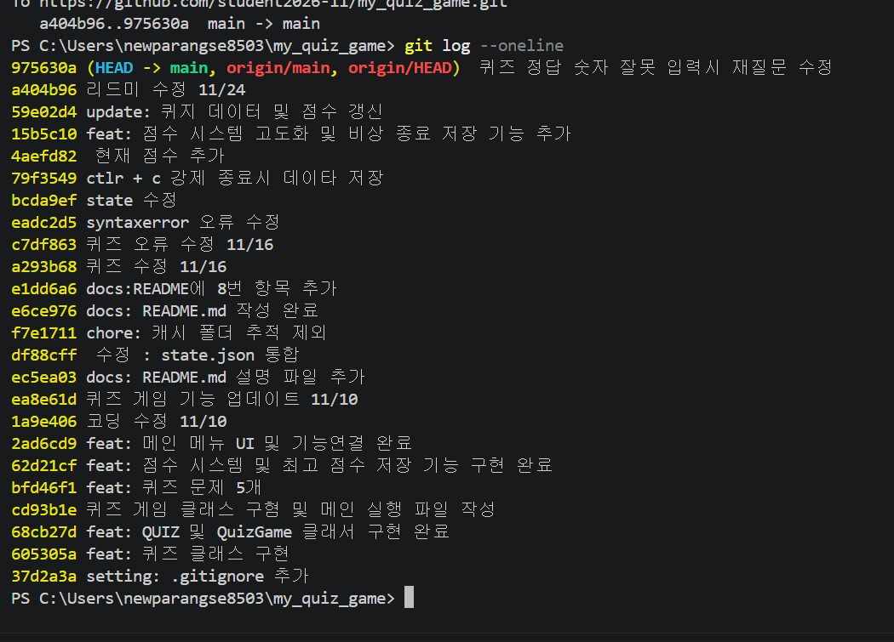

# 🎯 나만의 파이썬 상식 퀴즈 게임 (My Quiz Game)

파이썬을 활용하여 사용자가 퀴즈를 풀고, 직접 문제를 추가하며 점수를 관리할 수 있는 인터랙티브 콘솔 프로그램입니다.

---

## 1. 프로젝트 개요
이 프로젝트는 파이썬의 기초 문법, 파일 입출력(JSON), 객체 지향 프로그래밍(OOP: `Question`, `QuizManager` 클래스 설계), 그리고 Git 버전 관리를 실습하기 위해 제작되었습니다. 사용자는 기본 제공되는 상식 퀴즈를 순차 또는 랜덤으로 풀거나 새로운 퀴즈를 생성하여 나만의 퀴즈 데이터를 구축할 수 있습니다.

## 📂 프로젝트 구조
```text
my_quiz-game/
├── main.py          # 메뉴 입출력, 퀴즈 진행 루프(순차/랜덤), 비상 종료(SIGINT) 핸들러
├── quiz.py          # Question 및 QuizManager 클래스 정의, 퀴즈·점수 데이터(JSON) 파일 입출력 관리
├── state.json       # 퀴즈 데이터와 최고 점수가 저장되는 데이터 파일 (실행 시 자동 생성)
└── README.md        # 프로젝트 설명 및 학습 목표 정리
```

---

## 2. 퀴즈 주제와 선정 이유
- **주제**: 초등학생을 위한 일반 상식
- **선정 이유**: 누구나 쉽게 접근할 수 있는 상식 퀴즈(전통 의상, 수도, 태양계 행성, 색의 혼합 등)를 통해 프로그램의 활용도를 높이기 위함입니다.

---

## 3. 실행 방법
1. 원격 저장소를 로컬 환경에 복제(Clone)하고 프로젝트 폴더로 이동합니다.
   ```bash
   git clone <원격-저장소-URL>
   cd my_quiz-game
   ```
2. Python 3가 설치된 터미널에서 아래 명령어를 입력하여 프로그램을 실행합니다. (표준 라이브러리만 사용하므로 별도 패키지 설치가 필요 없습니다.)
   ```bash
   python main.py
   ```

---

## 4. 기능 목록 및 주요 업데이트 (New! ✨)
### 핵심 메뉴 기능 (`1` ~ `5`)
- **퀴즈 풀기**:
  - **출제 방식 선택 (Bonus ✨)**: 사용자가 **1. 순차 출제(등록된 순서대로)** 또는 **2. 랜덤 출제(무작위 순서)** 중 원하는 방식을 직접 선택할 수 있습니다.
  - **문제 수 선택 (Bonus ✨)**: 전체 등록된 문제 수(`1 ~ N`) 범위 내에서 풀고 싶은 문제 개수를 직접 지정할 수 있습니다.
  - **점수 계산**: 선택한 문제 수 대비 정답 비율을 100점 만점(`int((score / count) * 100)`)으로 환산하여 계산합니다.
- **점수 이력 관리**: 현재 세션의 '최근 점수(`last_score`)'와 파일에 저장된 '최고 점수(`best_score`)'를 분리하여 실력 향상을 확인할 수 있고, 최고 점수 달성 시 축하 메시지를 출력합니다.
- **퀴즈 관리**: 사용자가 직접 새로운 질문, 4개의 선택지, 정답 번호를 입력해 퀴즈를 추가하거나 전체 퀴즈 목록을 조회할 수 있습니다.
- **입력 검증**: 메뉴 선택, 출제 방식, 문제 수 및 정답 번호 입력 시 예외 처리(`try-except`)를 통해 잘못된 값이 들어와도 프로그램이 강제 종료되지 않도록 설계되었습니다.
- **데이터 안전 저장**: 정상 종료(`5`)는 물론, 프로그램 실행 중 `Ctrl+C`로 비상 종료하더라도 `signal` 처리를 통해 현재까지의 상태와 데이터를 안전하게 저장합니다.

---

## 5. 파일 구조
- `main.py`: 프로그램의 진입점으로 메뉴 출력, 사용자 입력 검증, 비상 종료(`SIGINT`) 핸들러 및 전체 퀴즈 진행 루프를 제어합니다.
- `quiz.py`: 개별 문제 모델(`Question`)과 퀴즈·점수 관리 로직(`QuizManager` 클래스)을 담당하며 `state.json` 파일 읽기/쓰기를 수행합니다.
- `state.json`: 퀴즈 데이터와 최고 점수가 저장되는 데이터 파일입니다.
- `README.md`: 프로젝트 설명, 사용법 및 과제 학습 목표가 작성된 문서입니다.

---

## 6. 기술적 세부 사항 (Refactoring)
진행된 주요 개선 사항입니다:
- **함수 분리**: `run_quiz_session()` 함수를 도입하여 퀴즈 실행 로직(출제 방식·문제 수 선택 및 채점)을 독립시키고 `main()`을 간결하게 유지해 코드 가독성을 높였습니다.
- **데이터 반환**: 퀴즈 세션 종료 후 `final_score`를 반환(`return`)받아 메인 메뉴에서 최근 점수(`last_score`)를 실시간으로 업데이트합니다.
- **무작위 추출 (`random.sample`)**: 원본 퀴즈 목록(`all_quizzes`)의 순서를 훼손하지 않기 위해 `shuffle()` 대신 `random.sample(all_quizzes, count)`를 사용하여 중복 없는 랜덤 문제 리스트를 생성합니다.
- **시그널 처리**: `signal.signal(signal.SIGINT, signal_handler)`로 `Ctrl+C` 인터럽트를 감지해 갑작스러운 종료 시에도 `manager.save_state()`를 호출하여 데이터 손실을 방지했습니다.

---

## 7. 데이터 파일 설명 (`state.json`)
- **파일 경로**: `my_quiz-game/state.json` (프로젝트 루트 디렉토리, 최초 실행 또는 저장 시 자동 생성)
- **역할**: 프로그램 종료 후에도 사용자가 추가한 퀴즈 목록과 역대 최고 점수를 영구 보존하고, 재실행 시 이전 상태를 복원하는 역할을 수행합니다. *(참고: `last_score`는 파일에 저장되지 않고 실행 세션 동안 메모리에서 관리됩니다.)*

### 데이터 스키마 (Schema)

| 필드명 | 타입 | 설명 |
| :--- | :--- | :--- |
| `quizzes` | `list[dict]` | 등록된 전체 퀴즈 문제 객체 리스트 |
| `quizzes[].question` | `str` | 퀴즈 질문 내용 |
| `quizzes[].options` | `list[str]` | 4개의 객관식 선택지 문자열 리스트 |
| `quizzes[].answer` | `int` | 정답 번호 (1부터 시작하는 정수, `1`~`4`) |
| `best_score` | `int` | 역대 최고 점수 기록 (`0`~`100`, 초기값 `0`) |

### 데이터 예시 (`state.json`)
```json
{
    "quizzes": [
        {
            "question": "우리나라의 전통 고유 의상은 무엇일까요?",
            "options": ["치파오", "기모노", "한복", "사리"],
            "answer": 3
        },
        {
            "question": "대한민국의 수도는?",
            "options": ["부산", "인천", "서울", "대구"],
            "answer": 3
        }
    ],
    "best_score": 100
}
```

---

## 8. Git 버전 관리 및 최종 푸시
`README.md` 및 보너스 기능 작성을 완료한 후, 아래 명령어를 실행하여 원격 저장소에 최종 반영합니다.

```bash
# 1. 변경된 파일 상태 확인
git status

# 2. 수정된 코드 및 README.md 스테이징
git add main.py README.md

# 3. 커밋 메시지 작성 및 저장
git commit -m "feat: 순차/랜덤 출제 및 문제 수 선택 기능 추가 및 README.md 완성"

# 4. 원격 저장소(main 브랜치)로 최종 푸시
git push origin main
```

---

## 9. 과제 목표 및 코드 연결 포인트

### ① Python 기초
- **변수와 사용 이유**: `score`, `final_score`, `last_score`, `choice`, `mode`, `count`, `question`, `options` 등 실행 중 변하는 값을 메모리에 저장해 재사용하고 프로그램 상태를 추적하기 위해 사용합니다.
- **자료형(`int`, `str`, `bool`, `list`, `dict`)의 차이**:
  - `int`: `score`, `final_score`, `answer`, `count` 등 정수 연산 및 크기·일치 비교에 사용합니다.
  - `str`: `choice == '1'`, `mode in ('1', '2')`, `question`, 안내 문구 등 문자열 데이터 처리에 사용합니다.
  - `bool`: `manager.update_best_score(final_score)`나 `q.is_correct(ans)`의 참/거짓 반환값처럼 조건 분기에 활용합니다.
  - `list`: `options`(선택지 목록)나 `quizzes`(퀴즈 목록)처럼 순서가 있는 복수 데이터를 다룰 때 사용합니다.
  - `dict`: JSON 직렬화·역직렬화 시 개별 퀴즈 항목(`{'question': ..., 'options': ..., 'answer': ...}`)처럼 **키(key)-값(value)** 쌍으로 구조화된 데이터를 표현할 때 사용합니다.
- **`if` / `elif` / `else` 조건 분기**: `main()`에서 `choice`에 따라 메뉴 동작(1~5)을 분기하고, `run_quiz_session()`에서 출제 방식(`mode`), 퀴즈 존재 여부, 정답 여부를 판별합니다.
- **`for`와 `while`의 차이와 선택**:
  - `for`: 퀴즈 목록(`selected_quizzes`), 선택지(`options`), 선택지 4개 입력(`range(1, 5)`)처럼 **반복 횟수나 순회할 요소가 정해져 있을 때** 사용합니다.
  - `while`: `main()`의 메뉴 루프나 유효한 숫자가 입력될 때까지 재입력받는 검증 루프처럼 **종료 조건(`break`)이 만족될 때까지 계속 반복해야 할 때** 사용합니다.
- **함수 정의, 매개변수, 반환값**: `signal_handler(sig, frame)`와 `run_quiz_session()`으로 기능을 분리해 책임을 나누고, `run_quiz_session()`이 `final_score`를 반환해 `main()`의 `last_score`를 갱신합니다.
- **표준 라이브러리(`random` 모듈) 활용**: `random.sample(all_quizzes, count)`를 학습·적용하여 기존 리스트의 순서를 변경하지 않고 원하는 개수만큼 무작위 비복원 추출을 구현했습니다.

### ② 클래스와 객체
- **클래스와 사용 이유**: `Question` 클래스로 개별 문제의 속성과 정답 판별(`is_correct`)을 모델링하고, `QuizManager` 클래스로 퀴즈 목록·점수 상태와 파일 입출력 메서드를 캡슐화하여 `main.py`가 저장소 구현 세부사항을 몰라도 일관된 메서드로 조작할 수 있게 합니다.
- **`__init__` 메서드와 `self`의 역할**: `QuizManager()` 인스턴스 생성 시 `__init__(self)`가 자동 실행되어 초기 퀴즈 목록과 최고 점수를 세팅하며, `self`는 생성된 각 객체 자신의 속성과 메서드에 접근하게 합니다.
- **속성(attribute)과 메서드(method)**: 퀴즈 데이터(`quizzes`), 최고 점수(`best_score`), 파일 경로(`filename`) 등을 객체의 속성으로 관리하고, `get_quizzes()`, `add_quiz()`, `update_best_score()`, `get_best_score()`, `save_state()` 같은 메서드로 상태를 읽고 변경합니다.

### ③ 파일 입출력
- **파일 열기·읽기·쓰기 기본 과정**: `open()`(권장 방식인 `with open(...) as f:`)으로 `state.json`을 열고, 기존 데이터를 읽어오거나(`json.load`) 변경된 상태를 저장(`json.dump`)한 뒤 파일을 닫아 종료 후에도 데이터가 남도록 합니다.
- **JSON 형식과 활용 이유**: `list`와 `dict`가 중첩된 퀴즈 구조와 점수를 사람이 읽기 쉽고 파이썬 자료구조와 직렬화·역직렬화가 쉬운 표준 텍스트 포맷(`JSON`)으로 저장하기 위해 사용합니다.
- **`try` / `except` 예외 처리**: `int(input(...))`에서 숫자가 아닌 값을 입력할 때 발생하는 `ValueError`를 잡아 프로그램 종료 대신 안내 메시지를 출력하며, 파일 입출력 과정의 파일 부재나 JSON 파싱 오류(`json.JSONDecodeError`, `IOError`)도 안전하게 방어합니다.

### ④ Git 기초
- **Git의 개념과 필요성**: 코드 변경 이력을 기록·추적하고, 과거 버전으로 복구하며, 여러 기능을 안전하게 실험하고 협업하기 위한 분산 버전 관리 시스템입니다.
- **주요 명령어 역할**:
  - `git init`: 현재 폴더를 새 Git 저장소로 초기화합니다.
  - `git add`: 작업 디렉터리의 변경 내용을 스테이징 영역에 추가합니다.
  - `git commit`: 스테이징된 변경 사항을 메시지와 함께 로컬 저장소 커밋 이력으로 남깁니다.
  - `git push`: 로컬 커밋을 원격 저장소(`origin`)에 업로드합니다.
  - `git pull`: 원격 저장소의 변경 사항을 가져와 현재 브랜치에 병합(`merge`)합니다.
  - `git checkout`: 브랜치를 이동하거나 작업 트리 상태를 되돌립니다(최근 Git에서는 브랜치 전환 시 `git switch`도 함께 사용합니다).
  - `git clone`: 원격 저장소를 로컬 환경에 복제합니다.
- **브랜치 생성과 병합**: 새 기능이나 리팩터링을 별도 브랜치에서 개발·검증한 뒤 메인 브랜치에 병합(`merge`)하여 안정적인 코드베이스를 유지합니다.
- **원격 저장소 복제 및 동기화**: `git clone`으로 저장소를 내려받은 뒤, 작업 전후 `git pull`로 최신 변경사항을 반영해 충돌을 예방합니다.


#====================================================================
# 🎯 나만의 파이썬 상식 퀴즈 게임 (My Quiz Game)

<!-- 파이썬을 활용하여 사용자가 퀴즈를 풀고, 직접 문제를 추가하며 점수를 관리할 수 있는 인터랙티브 콘솔 프로그램입니다.

---

## 1. 프로젝트 개요
이 프로젝트는 파이썬의 기초 문법, 파일 입출력(JSON), 객체 지향 프로그래밍(OOP: `Question`, `QuizManager` 클래스 설계), 그리고 Git 버전 관리를 실습하기 위해 제작되었습니다. 사용자는 기본 제공되는 상식 퀴즈를 풀거나 새로운 퀴즈를 생성하여 나만의 퀴즈 데이터를 구축할 수 있습니다.

---

## 2. 퀴즈 주제와 선정 이유
- **주제**: 초등학생을 위한 일반 상식
- **선정 이유**: 누구나 쉽게 접근하고 즐길 수 있는 상식 퀴즈(전통 의상, 수도, 태양계 행성, 색의 혼합 등)를 통해 프로그램의 활용도를 높이기 위함입니다.

---

## 3. 실행 방법
1. 원격 저장소를 로컬 환경에 복제(Clone)하고 프로젝트 폴더로 이동합니다.
   ```bash
   git clone <원격-저장소-URL>
   cd my_quiz-game
   ```
2. Python 3가 설치된 터미널에서 아래 명령어를 입력하여 프로그램을 실행합니다. (외부 라이브러리 설치 불필요)
   ```bash
   python main.py
   ```

---

## 4. 기능 목록 및 주요 구현 사항
### 핵심 메뉴 기능 (`1` ~ `5`)
1. **퀴즈 풀기**: 저장된 퀴즈를 순차적으로 풀며, 정답 비율을 100점 만점(`int((score / len(quizzes)) * 100)`)으로 환산해 계산합니다.
2. **퀴즈 추가**: 사용자가 직접 새로운 질문, 4개의 선택지, 정답 번호(1~4)를 입력해 퀴즈를 추가하면 즉시 `state.json`에 반영됩니다.
3. **퀴즈 목록**: 현재 저장된 전체 문제와 정답 번호를 한눈에 조회할 수 있습니다.
4. **점수 확인**: 현재 실행 세션의 **최근 점수(`last_score`)**와 파일에 영구 저장된 **최고 점수(`best_score`)**를 비교해 확인할 수 있습니다.
5. **종료**: 현재 상태를 `state.json`에 안전하게 저장한 뒤 프로그램을 종료합니다.

### 기술적 세부 사항 (Refactoring & Safety)
- **객체 지향 설계 (`Question` & `QuizManager`)**: 개별 퀴즈 데이터를 `Question` 객체로 캡슐화(`to_dict`, `from_dict`, `is_correct`)하고, `QuizManager`가 데이터 로드/저장 및 최고 점수 갱신을 전담합니다.
- **함수 분리 (`run_quiz_session`)**: 퀴즈 실행 루프를 별도 함수로 분리하여 `main()` 함수의 가독성을 높이고, 종료 시 `final_score`를 반환받아 `last_score`를 실시간 업데이트합니다.
- **입력 검증 및 예외 처리**: 메뉴 선택 및 정답 입력 시 `try-except ValueError`와 범위 검증(`1~4`)을 적용해 잘못된 입력에도 프로그램이 비정상 종료되지 않습니다.
- **비상 종료 데이터 보호 (`SIGINT`)**: `signal.signal(signal.SIGINT, signal_handler)`를 통해 실행 중 `Ctrl+C` 인터럽트가 발생하더라도 `manager.save_state()`를 호출해 데이터 손실을 방지합니다.

---

## 5. 파일 구조
```text
my_quiz-game/
├── main.py          # 메뉴 입출력, 퀴즈 진행 루프, 비상 종료(SIGINT) 핸들러
├── quiz.py          # Question 및 QuizManager 클래스 정의, JSON 파일 입출력 관리
├── state.json       # 퀴즈 문제 목록과 최고 점수가 저장되는 데이터 파일
└── README.md        # 프로젝트 설명, 스키마 및 Git 워크플로우 정리 문서
```
- `main.py`: 프로그램의 진입점으로 메뉴 출력, 사용자 입력 검증, `run_quiz_session()` 제어 및 `SIGINT` 시그널 처리를 담당합니다.
- `quiz.py`: 개별 문제 모델(`Question`)과 데이터 관리 로직(`QuizManager`)을 정의하며, `state.json`이 없을 경우 기본 5문제를 자동 초기화합니다.
- `state.json`: 등록된 퀴즈 목록(`quizzes`)과 역대 최고 점수(`best_score`)가 저장되는 로컬 데이터 파일입니다.
- `README.md`: 프로젝트 개요, 실행 방법, 데이터 스키마 및 Git 배포 절차가 정리된 문서입니다.

---

## 6. 데이터 파일 설명 (`state.json`)
- **파일 경로**: `my_quiz-game/state.json` (프로젝트 루트 디렉토리, 최초 실행 또는 저장 시 자동 생성)
- **역할**: 프로그램 종료 후에도 사용자가 추가한 퀴즈 목록과 역대 최고 점수를 영구 보존하고, 재실행 시 이전 상태를 복원하는 역할을 수행합니다. *(참고: `last_score`는 파일에 저장되지 않고 실행 세션 동안 메모리에서 관리됩니다.)*

### 데이터 스키마 (Schema)

| 필드명 | 타입 | 설명 |
| :--- | :--- | :--- |
| `quizzes` | `list[dict]` | 등록된 전체 퀴즈 문제 객체 리스트 |
| `quizzes[].question` | `str` | 퀴즈 질문 내용 |
| `quizzes[].options` | `list[str]` | 4개의 객관식 선택지 문자열 리스트 |
| `quizzes[].answer` | `int` | 정답 번호 (1부터 시작하는 정수, `1`~`4`) |
| `best_score` | `int` | 역대 최고 점수 기록 (`0`~`100`, 초기값 `0`) |

### 데이터 예시 (`state.json`)
```json
{
    "quizzes": [
        {
            "question": "우리나라의 전통 고유 의상은 무엇일까요?",
            "options": ["치파오", "기모노", "한복", "사리"],
            "answer": 3
        },
        {
            "question": "대한민국의 수도는?",
            "options": ["부산", "인천", "서울", "대구"],
            "answer": 3
        }
    ],
    "best_score": 100
}
```

---

## 7. Git 버전 관리 및 최종 푸시
`README.md` 작성을 완료한 후, 아래 명령어를 실행하여 원격 저장소에 최종 반영합니다.

```bash
# 1. 변경된 파일 상태 확인
git status

# 2. README.md 스테이징
git add README.md

# 3. 커밋 메시지 작성 및 저장
git commit -m "docs: README.md 작성 및 최종 프로젝트 문서화"

# 4. 원격 저장소(main 브랜치)로 최종 푸시
git push origin main
``` -->


================================================================================


<!-- # 🐍 파이썬 퀴즈 게임 (Python Quiz Game)

파이썬을 활용하여 사용자가 퀴즈를 풀고, 직접 문제를 추가하며 점수를 관리할 수 있는 인터랙티브 콘솔 프로그램입니다.

---

## 1. 프로젝트 개요
이 프로젝트는 파이썬의 기초 문법, 파일 입출력(JSON), 객체 지향 프로그래밍(OOP)의 기초, 그리고 Git 버전 관리를 실습하기 위해 제작되었습니다. 사용자는 저장된 퀴즈를 풀거나 새로운 퀴즈를 생성하여 나만의 퀴즈 데이터를 구축할 수 있습니다.

## 📂 프로젝트 구조

```text
my_quiz-game/
├── main.py          # 메뉴 입출력, 퀴즈 진행 루프, 비상 종료(SIGINT) 핸들러
├── quiz.py          # QuizManager 클래스 정의 및 퀴즈·점수 데이터(JSON 등) 파일 입출력 관리
└── README.md        # 프로젝트 설명 및 학습 목표 정리
```
---

## 2. 퀴즈 주제와 선정 이유
- **주제**: 초등학생을 위한 일반 상식
- **선정 이유**: 누구나 쉽게 접근할 수 있는 상식 퀴즈를 통해 프로그램의 활용도를 높이기 위함입니다.

---

## 3. 주요 기능 및 업데이트 (New! ✨)
- **퀴즈 풀기**: 저장된 퀴즈를 순차적으로 풀며, 100점 만점 체계로 점수가 계산됩니다.
- **점수 이력 관리**: '최근 점수(`last_score`)'와 '최고 점수(`high_score` / `best_score`)'를 분리하여 사용자의 실력 향상을 한눈에 확인할 수 있고, 최고 점수 달성 시 축하 메시지를 출력합니다.
- **퀴즈 관리**: 사용자가 직접 새로운 질문, 4개의 선택지, 정답 번호를 입력해 퀴즈를 추가하거나 전체 퀴즈 목록을 조회할 수 있습니다.
- **입력 검증**: 정답 번호 및 메뉴 입력 시 예외 처리(`try-except`)를 통해 숫자가 아닌 잘못된 값이 들어와도 프로그램이 강제 종료되지 않도록 설계되었습니다.
- **데이터 안전 저장**: 정상 종료(`5`)는 물론, 프로그램 실행 중 `Ctrl+C`로 비상 종료하더라도 `signal` 처리를 통해 현재까지의 상태와 데이터를 안전하게 저장합니다.
- **퀴즈 관리: 사용자가 직접 새로운 질문과 정답을 추가하거나 전체 목록을 조회할 수 있습니다.


---

## 4. 실행 방법
1. 저장소를 내려받고 프로젝트 폴더로 이동합니다.
   ```bash
   git clone <원격-저장소-URL>
   cd <프로젝트-폴더명>
   ```
2. 프로그램이 설치된 Python 3 환경의 터미널에서 아래 명령어를 입력하세요.
   ```bash
   python main.py
   ```

---

## 5. 파일 구조
- `main.py`: 프로그램의 진입점으로 메뉴 출력, 사용자 입력 검증, 비상 종료(`SIGINT`) 핸들러 및 전체 퀴즈 진행 루프를 제어합니다.
- `quiz.py`: 퀴즈 및 점수 관리 로직(`QuizManager` 클래스)을 담당하며 `state.json` 파일 읽기/쓰기를 수행합니다.
- `state.json`: 퀴즈 데이터와 최고 점수가 저장되는 데이터 파일입니다.
- `README.md`: 프로젝트 설명, 사용법 및 과제 학습 목표가 작성된 문서입니다.

---

## 6. 기술적 세부 사항 (Refactoring)
진행된 주요 개선 사항입니다:
- **함수 분리**: `run_quiz_session()` 함수를 도입하여 퀴즈 실행 로직을 독립시키고 `main()`을 간결하게 유지해 코드 가독성을 높였습니다.
- **데이터 반환**: 퀴즈 세션 종료 후 `final_score`를 반환(`return`)받아 메인 메뉴에서 최근 점수(`last_score`)를 실시간으로 업데이트합니다.
- **시그널 처리**: `signal.signal(signal.SIGINT, signal_handler)`로 `Ctrl+C` 인터럽트를 감지해 갑작스러운 종료 시에도 `manager.save_state()`를 호출하여 데이터 손실을 방지했습니다.

---

## 7. 데이터 파일 구조 (`state.json`)
```json
{
  "quizzes": [
    {
      "question": "질문 내용",
      "options": ["선택지 1", "선택지 2", "선택지 3", "선택지 4"],
      "answer": 1
    }
  ],
  "high_score": 0
}
```

---

## 8. Git 관리
```bash
# 수정 사항 반영 및 푸시
git add .
git commit -m "feat: 점수 시스템 고도화 및 비상 종료 저장 기능 추가"
git push origin main
```

---

## 9. 과제 목표 및 코드 연결 포인트


### ① Python 기초
- **변수와 사용 이유**: `score`, `final_score`, `last_score`, `choice`, `question`, `options` 등 실행 중 변하는 값을 메모리에 저장해 재사용하고 프로그램 상태를 추적하기 위해 사용합니다.
- **자료형(`int`, `str`, `bool`, `list`, `dict`)의 차이**:
  - `int`: `score`, `final_score`, `answer` 등 정수 연산 및 크기·일치 비교에 사용합니다.
  - `str`: `choice == '1'`, `question`, 안내 문구 등 문자열 데이터 처리에 사용합니다.
  - `bool`: `manager.update_best_score(final_score)`의 참/거짓 반환값처럼 조건 분기에 활용합니다.
  - `list`: `options`(선택지 목록)나 `quizzes`(퀴즈 목록)처럼 순서가 있는 복수 데이터를 다룰 때 사용합니다.
  - `dict`: 개별 퀴즈 항목(`q['question']`, `q['options']`, `q['answer']`)처럼 **키(key)-값(value)** 쌍으로 구조화된 데이터를 표현할 때 사용합니다.
- **`if` / `elif` / `else` 조건 분기**: `main()`에서 `choice`에 따라 메뉴 동작(1~5)을 분기하고, `run_quiz_session()`에서 퀴즈 존재 여부와 정답 여부를 판별합니다.
- **`for`와 `while`의 차이와 선택**:
  - `for`: 퀴즈 목록(`quizzes`), 선택지(`options`), 선택지 4개 입력(`range(1, 5)`)처럼 **반복 횟수나 순회할 요소가 정해져 있을 때** 사용합니다.
  - `while`: `main()`의 메뉴 루프처럼 **종료 조건(`break`)이 만족될 때까지 계속 반복해야 할 때** 사용합니다.
- **함수 정의, 매개변수, 반환값**: `signal_handler(sig, frame)`와 `run_quiz_session()`으로 기능을 분리해 책임을 나누고, `run_quiz_session()`이 `final_score`를 반환해 `main()`의 `last_score`를 갱신합니다.

### ② 클래스와 객체
- **클래스와 사용 이유**: `QuizManager` 클래스로 퀴즈 목록·점수 상태와 관리 메서드를 캡슐화하여, `main.py`가 저장소 구현 세부사항을 몰라도 일관된 메서드로 조작할 수 있게 합니다.
- **`__init__` 메서드와 `self`의 역할**: `QuizManager()` 인스턴스 생성 시 `__init__(self, ...)`이 자동 실행되어 초기 퀴즈 목록과 최고 점수를 세팅하며, `self`는 생성된 각 객체 자신의 속성과 메서드에 접근하게 합니다.
- **속성(attribute)과 메서드(method)**: 퀴즈 데이터·점수·파일 경로 등을 객체의 속성으로 관리하고, `get_quizzes()`, `add_quiz()`, `update_best_score()`, `get_best_score()`, `save_state()` 같은 메서드로 상태를 읽고 변경합니다.

### ③ 파일 입출력
- **파일 열기·읽기·쓰기 기본 과정**: `open()`(권장 방식인 `with open(...) as f:`)으로 `state.json`을 열고, 기존 데이터를 읽어오거나(`load` / `read`) 변경된 상태를 저장(`dump` / `write`)한 뒤 파일을 닫아 종료 후에도 데이터가 남도록 합니다.
- **JSON 형식과 활용 이유**: `list`와 `dict`가 중첩된 퀴즈 구조와 점수를 사람이 읽기 쉽고 파이썬 자료구조와 직렬화·역직렬화가 쉬운 표준 텍스트 포맷(`JSON`)으로 저장하기 위해 사용합니다.
- **`try` / `except` 예외 처리**: `int(input(...))`에서 숫자가 아닌 값을 입력할 때 발생하는 `ValueError`를 잡아 프로그램 종료 대신 안내 메시지를 출력하며, 파일 입출력 과정의 파일 부재나 형식 오류도 안전하게 방어합니다.

### ④ Git 기초
- **Git의 개념과 필요성**: 코드 변경 이력을 기록·추적하고, 과거 버전으로 복구하며, 여러 기능을 안전하게 실험하고 협업하기 위한 분산 버전 관리 시스템입니다.
- **주요 명령어 역할**:
  - `git init`: 현재 폴더를 새 Git 저장소로 초기화합니다.
  - `git add`: 작업 디렉터리의 변경 내용을 스테이징 영역에 추가합니다.
  - `git commit`: 스테이징된 변경 사항을 메시지와 함께 로컬 저장소 커밋 이력으로 남깁니다.
  - `git push`: 로컬 커밋을 원격 저장소(`origin`)에 업로드합니다.
  - `git pull`: 원격 저장소의 변경 사항을 가져와 현재 브랜치에 병합(`merge`)합니다.
  - `git checkout`: 브랜치를 이동하거나 작업 트리 상태를 되돌립니다(최근 Git에서는 브랜치 전환 시 `git switch`도 함께 사용합니다).
  - `git clone`: 원격 저장소를 로컬 환경에 복제합니다.
- **브랜치 생성과 병합**: 새 기능이나 리팩터링을 별도 브랜치에서 개발·검증한 뒤 메인 브랜치에 병합(`merge`)하여 안정적인 코드베이스를 유지합니다.
- **원격 저장소 복제 및 동기화**: `git clone`으로 저장소를 내려받은 뒤, 작업 전후 `git pull`로 최신 변경사항을 반영해 충돌을 예방합니다.



 -->
